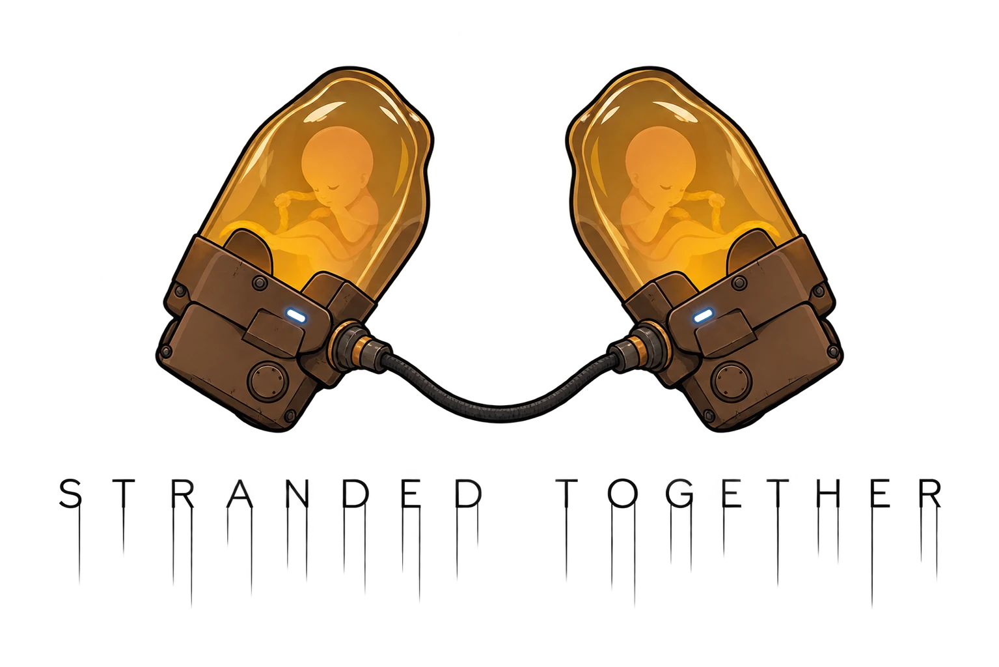

<p align="center">
  
</p>

<p align="center">
  <b>Two-player online co-op for DEATH STRANDING DIRECTOR'S CUT</b><br>
  Windows · Steam · <a href="https://github.com/TrollTaylor/stranded-together/releases">Releases</a>
</p>

Built on the launcher and network stack of
[Diamond Dogs Together](https://github.com/TrollTaylor/diamond-dogs-together) (MGSV co-op).
Not affiliated with Kojima Productions, 505 Games or Sony Interactive Entertainment.

## Milestone 1: two players, synced

- Two players connect over Steam (Steam Networking Messages, relayed, no port forwarding)
  with a join code `DST1-XXXXX-XXXXX-XXXXX-XXXXX-CC@<host SteamID64>`.
- Each player sees the other in their world, moved to the partner's position and facing
  at 30 Hz with 100 ms interpolation.
- **Experimental:** the partner is a solid character that copies the other player's real
  animation (walking, running, stopping). The guest plays Fragile in her porter suit (other
  characters can be picked with Debug > Allow other characters); the host is always Sam. A
  partner shown as Sam wears the other player's own suit and colour (porter, silver or gold).
  The guest appears as Fragile on their own screen too. If the real character cannot be shown, the partner appears as a hologram
  instead. See [docs/real-partner-body.md](docs/real-partner-body.md).
- The partner's name floats above their head (your co-op name, or your Steam name), in the
  game's own menu font, read from your installed game (Segoe UI for characters it lacks).
- Players cannot walk through each other: on foot, your partner's body stops you like
  another character does. You cannot climb onto your partner.
- The other player's movement stays smooth at high frame rates: both bodies get a new pose
  every frame (tested up to about 113 fps).
- **Experimental:** what each player carries shows on their character on the other screen:
  the backpack with its bag, rain cover and pouches, stowed weapons, shoulder shields, hanging
  boots, delivery cases, the Bridges cap, the BB pod (a stand-in model) and Sam's exoskeleton
  parts (on a Sam body), in the colours the owner sees (a gold or silver cap, the backpack's
  paint); the backpack frame extends with the load as on the owner's screen. A partner shown as
  Sam has the other player's own hair and head (cap hair, the metal face lines).
  When you appear as another character, your own real gear, cap, glasses, equipped boots and
  weapons show on you, fitted to your character's body (the cap and glasses placed for
  Fragile's head), and the cargo menu (Manage Cargo) shows your character instead of Sam. Fragile
  keeps her own boots on both screens, painted with your boots pictures of the equipped boot type
  (or, with Tools > Fragile's textures > "Sam's boots on her feet", Sam's real boots over hers).
- **Experimental:** weapons in hand show on the other screen: the assault rifle, handgun,
  shotgun, multi rod and the grenades (as the game's cutscene models, in their own colours).
- **Experimental (round 6):** whatever else is in a player's hand shows in that hand on the other screen too: the
  ladder (folded, and unfolded over the shoulder while aiming it), the PCC, the climbing anchor, the container repair
  spray and any other tool or weapon, drawn from the item's own model (docs/real-partner-body.md section 31;
  session.ini `held_items`, default 2).
- **Experimental:** structures either player builds with the PCC (postboxes, watchtowers, generators, shelters,
  bridges, ...) appear in both worlds with the build-up on both screens, a dismantle removes them from both, and they
  stay in the host's save (docs/world-sync.md; on with **Host holds the save**, Debug option **Share structures,
  ladders, ropes and ziplines**). Both players can pay materials into the same structure (upgrades, repairs) from their own
  inventories toward one shared total, and the level-up plays on both screens. Ladders and climbing ropes either player
  places appear in both worlds, both players can climb them, and collapsing / recovering one removes it from both
  worlds (the item goes back to whoever picked it up). Ziplines either player builds appear in both worlds, connect to
  the same ziplines in both, can be upgraded by either player and stay in the host's save. Nothing the mod creates is
  sent to the game's online servers.
- **Experimental:** vehicles are shared (with **Host holds the save**, the default): every
  vehicle is **one real vehicle**, the same one on both screens, never a copy and never a
  hologram. Each of you can summon your own (the guest's summons come from the host's garage
  stock); when your partner drives, the vehicle drives in your world too, with them seated in
  it, and when they park it, it stands there for you as well. One driver at a time: while
  your partner drives a vehicle you cannot get in (if you both press X at once, the host
  gets it). The driver's game decides the damage; the other world copies it. Cargo your
  partner put on the vehicle shows on it (cannot be picked up yet). Online vehicles of other
  players are hidden during co-op. Without **Host holds the save** you see a solid copy of
  your partner's trike or truck (no roadster, no hologram).
- **Experimental:** riding together (with the shared vehicles): walk up to the vehicle your
  partner drives; the game's own **Use Vehicle** is available on it while it stands still.
  Press it (F on the keyboard, X / Square on the pad) to ride along in the passenger seat
  (the trike: on the pillion behind the driver). Press X / F again to get off (below walking
  pace; at speed you get off as soon as it slows down, a second press jumps off). If this
  game build differs, a co-op banner says so and you hold X / F beside the passenger door
  instead. You are put off by yourself if the
  link drops, the driver gets off, the vehicle crashes, flips or breaks, or the game needs
  your Sam (a cutscene, a load). While you ride you can look around but not move or act;
  you sit in your partner's driving pose (hands on a wheel that is not there).
- **Experimental:** your partner's vehicle hits you like an enemy MULE truck: drive into
  your partner above about 15 km/h and they are knocked down and hurt on their screen (the
  game's own hit; you see them fall on yours). It never kills at once, however fast. A
  passenger thrown off in a crash is knocked down the same way. The truck hits only you in
  your world (not the NPCs or the cargo lying around you); the trike and the roadster use the
  game's own hit area. Vehicles bump into each other on both screens. Turn it off for
  yourself on the launcher's Debug page: **Partner's vehicles can knock me down** (each
  player decides for their own Sam).
- **Experimental:** your partner's gunfire: every bullet their gun fires appears on your
  screen from their body's gun, with the game's own muzzle flash, tracer and impacts. It is
  visual only: their bullets do nothing in your world (you, your vehicles, cargo, structures
  and enemies take no damage from them). Your enemies do not react to being hit, but the
  noise of the impacts can still alert them: when your partner shoots up a camp, your own
  copy of that camp may wake up and come at you. Grenades, bolas and launchers are not shown
  yet. The gunshot sound plays at the replay; with **Hear your partner's footsteps and
  sounds** on, the game may also play your partner's own gunshot. Turn it off for your own
  screen on the launcher's Debug page: **Show my partner's gunfire**.
- **Experimental:** shared enemies (when the host holds the save): the host's MULEs are the
  real ones. Near the guest, her own MULEs stand where the host's are and move like them, and
  when the host's MULEs fire at the host, the guest sees those shots too (muzzle flash and
  tracer from her copy of the MULE). The guest's hits count: when she shoots one of those
  MULEs with non-lethal rounds, her hit is sent to the host and the host's game applies it to
  its own MULE with the game's own damage, so the MULE flinches and faints on both screens
  (tested; falling asleep is coded but not yet tested in co-op) and lies where it fell on both
  for the 6 MULEs nearest to her (a farther one she downs is placed but not posed: it may stand
  on her screen). A takedown counts as the host's, in the host's save. Her lethal rounds are
  refused for now (their kills are not tested). On her screen the MULE's reaction comes from
  the host's frames a fraction of a second later; its pain voice, her own copy's hit reaction
  and her HUD's markers for a downed MULE are not shown, and grenades, bolas, melee, tying up
  and truck rams are untested. It is not the same for both players yet: a MULE she has not
  hit ignores her and goes only for the host. Once she hits one, it turns on her: on the
  host's screen it goes for her body, on hers her copy of it follows the host's frames, and
  its gunfire at her can reach her and hurt her; its melee, thrown spears and tackles cannot.
  The host's MULE rounds can also hurt the guest if they cross her; the host's melee, thrown
  spears, tackles, cargo theft and truck rams never reach her. A downed MULE that she walks
  away from stands up again in her world until she comes back (it then lies with the host's
  again). There is no launcher switch yet.
- Not yet: the tools' effects (the PCC's and anchor's build holograms, the spray), the Odradek, the cuff device,
  the weapon crate on the hip, the chiral cylinder, the exoskeleton on non-Sam characters,
  facial animation, the partner's gear sounds (footsteps, movement and
  rifle handling are heard, experimental), thrown grenades, bolas and launcher rounds, the game's own passenger animation, a vehicle
  camera for the passenger, shared cargo on vehicles, carts (and for the copies without Host holds the
  save: a roadster, the Kusanagi's own look, mud / snow, the light the lamps throw, damage),
  world/BT/mission sync.

## Download

Get `StrandedTogether-<version>.zip` from [Releases](https://github.com/TrollTaylor/stranded-together/releases). Both players need the **same version**.

The launcher updates itself: when a new version is out, Play shows **Update now**, which downloads it, checks it, installs it and restarts the launcher (not while the game runs). **About → Check for updates** looks again; the check when the launcher opens can be switched off there. The launcher's only network access is that check against this repository's releases and, on **Update now**, the download of the new zip.

## Install

1. In Steam, right-click DEATH STRANDING DIRECTOR'S CUT and choose **Manage → Browse local files**. This opens the game folder, the one with `ds.exe`.
2. Extract **everything** from `StrandedTogether-<version>.zip` into that folder: `StrandedTogether.exe`, `winhttp.dll` and the `stranded_together` folder.
3. Run **StrandedTogether.exe**.

The launcher checks that it sits next to `ds.exe` (otherwise it shows where Steam has the game, with **Open my game folder**), the game version, and that `winhttp.dll` is the one from the zip (`stranded_together\package.json`). Another program's `winhttp.dll` is reported and never replaced.

Starting the game from Steam on its own runs it unmodded: each start from the launcher writes a one-shot `stranded_together\session.ini` that the mod uses up.

## Play

1. **Host:** **Play → Host → Host game**. The game starts through Steam and a join code is copied to your clipboard; send it to your partner. The host always appears as Sam.
2. **Join:** **Play → Join**, paste the code, **Join game**. You play **Fragile (porter suit)**; with **Debug → Allow other characters** you can pick another character under **Your character** (Sam, Die-Hardman, Cliff, Deadman, Higgs and others). The host sees you as that character when both games use the real character (Debug → Partner body), and on your own screen you appear as it too (Debug → See yourself as your character). Unless you play Sam, his voice (lines, grunts, breathing) is silenced on your own game (Debug → Mute Sam's voice when you are not Sam). The host hears nothing of Sam from a partner who is not Sam, and you hear the host's Sam from his body (Debug → Hear your partner's voice). Each of you also hears the other's footsteps, movement and weapon sounds from their body (Debug → Hear your partner's footsteps and sounds; experimental), at the volume set by Debug → Partner sound volume. **Advanced** switches to LAN / VPN (UDP) and sets your name.
3. **Solo test:** **Play → Solo test** starts the game with an echo, a copy of you that replays your movement. No partner, no network.

Keep the launcher open to see the connection on **In game**; closing it is safe (a hidden helper tidies up after the game exits).

### One world: the host holds the save (new, experimental)

With **Debug → Host holds the save** (on by default) there is one world, the host's. See [docs/coop-session.md](docs/coop-session.md).

- **Host:** you play on your own saves, exactly as in single player. Pick **Continue**, **Load** or **New Game** on your title screen as usual; your partner joins the world you start. Co-op progress is saved into **your own save** by the game itself. Before each co-op session the launcher copies your saves to `stranded_together\backups` (the newest 5 are kept; **Debug → Back up my saves before co-op**).
- **Guest:** your game never opens your own saves. It skips the boot logos and opens on the game's own title screen, whose menu has only **Waiting for <host> to start the game** and **Quit Game**; that line follows the connection, the transfer ("Receiving <host>'s save: 45%") and the load. It cannot enter a world by itself. When the host starts, the host's save comes over the connection and your game loads it: you appear where the host's Sam was when that save was made. **Quit Game** quits the game.
- **What the guest's progress means:** the guest plays a **disposable copy of the host's world**. Orders, deliveries, porter grade, likes, equipment, materials, structures and story progress made only on the guest's side are **not kept**: they are gone at the host's next load and when the session ends. The guest spawns as a copy of the host's Sam at save time (the same cargo and orders); delivering that cargo on the guest's side changes nothing for the host. Your settings and controls changed during co-op are kept for the next co-op session (in the co-op folder only). Your real saves are never touched.
- **The black rain cover over the backpack wears out in timefall** (single player does the same). Both games load the host's save, so both Sams' covers wear out at about the same time; when one breaks, the game removes it from that Sam, so it also disappears from Fragile's back on both screens. Fabricate and equip a new one to get it back. The log says so: `[gear] wear: the backpack's rain cover broke`.
- **When the host...** loads another save, retries after a Game Over or quits to the title, the guest follows: it loads the same save (a Retry uses the host's newest autosave, which can differ slightly from the exact retry point), or goes back to its title and waits again. A **New Game** host: the guest waits until the host's first save. A guest who joins while the host is already playing loads the host's newest save and is offered **Teleport to host** once (in the F9 menu).
- **Connection lost:** the guest keeps playing with a "Reconnecting..." notice; after 60 s it goes back to the waiting screen and rejoins the host's world when the connection is back.
- **Game versions:** both games must be the same version; otherwise both screens say "Game versions differ" and the guest does not load anything.
- **Not verified yet:** achievements, Steam stats and online features (likes, shared structures) on the guest's account may still react to events in the host's world.
- Turn the option off for the old mode: each player on their own save. That mode has no waiting screen, no shared vehicles (the partner's vehicles are see-through copies), no riding together and no vehicle hits: the launcher says so on the Play page and both games show an amber "Co-op features OFF" notice.
- **Debug → Test saves → Local two-player test** (two games on one PC) plays this same session since v0.19: the guest window waits for the host and loads the host's save, the vehicles are shared, you can ride together. Both games run on copies of the test save, never on your own saves.
- **Local test controls:** the mouse stays inside the game window you play in (Debug option **Lock the mouse to the focused game window (Local test)**, on by default): **F10** jumps to the other game's window (F11 when your menu key is F10), **Alt+Tab** or the Win key leave, **F9** opens the debug menu in the game in front. The hint at the top left says so when you are in the world.

### Fragile's textures: paint her suit and boots (new)

The launcher copies Fragile's porter suit and boots pictures, and every Sam suit style (palette, silver, gold) and boot type for reference, out of your own game into `Documents\Stranded Together\Textures` as PNG files you can paint: one folder per Sam suit colour (`00 Default` ... `16 Gold`) and per boot type. It does this by itself in the background the first time it starts (and after an update that changes the pictures; about 8 seconds, you can play meanwhile), or with **Tools → Fragile's textures → Extract textures**. Extracting again never overwrites what you painted; **Check my edits** lists what you changed. In a co-op session the guest's Fragile wears the suit pictures you edited for your Sam's suit colour, on your screen and on your partner's (sent over the link, then cached); a saved picture shows a few seconds later. A colour you did not paint shows a **ready-made Fragile colour** made on your PC from her own pictures: her navy fabric in your Sam's colour, a polished gold or silver for `16 Gold` / `15 Silver`, `00 Default` her own suit (the card's **READY-MADE COLOURS: Off** gives her own navy suit instead; the v0.23 colour tint is an option, `fragile_suit_colour=1`). Her boots wear the pictures you painted for the boot type the guest's Sam has equipped (her own boots' shape, on both screens; worn-out boots use `Worn\`); the card's "Her boots" choice switches to Sam's real boots on her feet instead. See [docs/textures.md](docs/textures.md).

## Debug

The launcher's **Debug** page:

- **Options:** **Debug tools only (solo)** starts the game with just the in-game debug menu and logging (no partner, no network), or the **Echo test**; echo delay and offset, send rate, interpolation delay, waking the partner clone, verbose logging, the **in-game debug menu** on/off with its key (**F9** by default, F1–F12; v0.19.0 and earlier swallowed the key in the real game without opening the menu: fixed), **Lock the mouse to the focused game window (Local test)** (default on, Local test only), and **Partner body**: **Real character (experimental)** (default) or **Hologram**: how your partner is drawn on your screen, and with Hologram your partner sees you as a hologram too (a hologram game does not send your character). These options go into every game started from the launcher.
- **Files and log:** open the mod folder or log, a live tail of `stranded_together.log` with **Copy log**, **Copy error.txt** (the game's crash report), **Disable mod / Enable mod** (renames `winhttp.dll` ↔ `winhttp.dll.disabled`) and **Clear session** (deletes `session.ini`).
- **Tools → Collect logs** puts a zip for a bug report on the Desktop (codes, secrets and Steam IDs removed).

### Dev tools

Tick **Dev tools** on the Debug page and the in-game debug menu (F9) gets a **Dev tools** tab (mouse or pad, on the host and
the guest): spawn any of the game's 14 vehicles (roadster, truck, trike and their variants) in front of you, remove the last
one or the nearest, repair and recharge a vehicle; refill health, stamina and battery; god mode and infinite ammo; teleport
to your partner or to any delivery point, city, prepper, camp or distribution center of the current region; time of day;
timefall on (light or heavy) or clear skies; bring back every MULE and terrorist, remove them, or reset the BTs; new boots
and chiral crystals.

Anything that changes what a save keeps (vehicles, weather, enemies, items) works only on a test save, such as the Local
test: a game on your real save refuses it and says why. In a co-op session a vehicle you spawn is the host's, shared with
both games; the guest's spawn is asked of the host's game. God mode does not stop a fatal fall. Every tool is also a debug
action for the hidden tests (docs/debug-actions.md, "Dev tools").

The tab's **Story** section shows where the story stands (episode, the orders in progress, how many are done) and lists the
test save's manual saves as **story points**: pick one and **Load story point** jumps there with the game's own Load Game
(test saves only; in a co-op session the host loads and the guest follows). `tools\testenv\Story-Library.ps1` collects saves
at known story points into one test-save folder (`testenv-saves\story-pack`) to pick for the Local test. There is no mission
skip: the game's orders are scripted and a forced start can soft-lock the story (docs/dev-tools.md).

## Uninstall

Quit the game and delete `StrandedTogether.exe`, `winhttp.dll` and the `stranded_together` folder from the game folder (or **Debug → Disable mod** to keep the files and play unmodded).

## How it works

| Piece | Where | Notes |
|---|---|---|
| Loader | `native/mod/dllmain.cpp` → `winhttp.dll` | ds.exe imports winhttp; the proxy forwards all 92 exports to System32 and starts the mod on its own thread. Does nothing unless `stranded_together\session.ini` exists. |
| Engine bindings | `native/mod/game_api.*` | Local player, Get/SetWorldTransform, EntityResource::CreateEntity, Entity::Remove — found by RE, located by signature. See [docs/reverse-engineering.md](docs/reverse-engineering.md). |
| Frame hook | `dllmain.cpp` | MinHook on the game's `SteamAPI_RunCallbacks` wrapper (main loop). |
| Sync | `native/mod/player_sync.*` | Sends local pose, interpolates the partner (position lerp + rotation slerp), spawns the partner from the local player's own EntityResource. |
| Link | `native/mod/link.*` + `native/net/*` | DDT's link v2 (HMAC-authenticated handshake, keepalive, RTT) over Steam or UDP. |
| Steam | `native/mod/steam_owner.*` | Gets `SteamNetworkingMessages002` from steamclient through the game's old steam_api (same trick as DDT on MGSV). |
| Launcher | `native/launcher/*` → `StrandedTogether.exe` | DDT's launcher, rebranded: Host / Join / Solo test, Debug page, checks the install against `package.json`, writes a one-shot `session.ini`, starts DS through Steam, updates itself from GitHub Releases. See [docs/launcher.md](docs/launcher.md). |

## Build

Visual Studio 2022 Build Tools (or newer) and CMake 3.20+.

```bash
cmake -S . -B build -G "Visual Studio 17 2022" -A x64
cmake --build build --config Release
ctest --test-dir build -C Release
```

Outputs: `build/Release/winhttp.dll` (the mod), `build/Release/StrandedTogether.exe`
(launcher), `build/Release/st_fakepeer.exe` (test partner).

Release zip: `.\tools\package.ps1` builds and writes `dist\StrandedTogether-<version>.zip`
(see [docs/packaging.md](docs/packaging.md)); `.\tools\deploy.ps1 -Package` installs it into
the game folder for a test. A release (version bump, clean build, all tests, zip, tag, GitHub
release that the launchers offer): `.\tools\release.ps1 -DryRun`, then `.\tools\release.ps1`
(see [docs/releasing.md](docs/releasing.md)).

## Testing (see [docs/testing.md](docs/testing.md))

1. **Solo, no network** — `tools\deploy.ps1 -Session echo`, start DS from Steam, load a save.
   A second Sam should follow your path 2 s behind you, 1.5 m to the side.
2. **One PC, real network path** — `tools\deploy.ps1 -Session udp-host`, start DS, then run
   `build\Release\st_fakepeer.exe --role guest --local 27556 --remote 27555`.
   The fake partner circles you.
3. **Two PCs over Steam** — both put `StrandedTogether.exe` + `winhttp.dll` in the game folder;
   one clicks Host and sends the code, the other pastes it under Join.

In game: **F6** logs both positions to `stranded_together\stranded_together.log`, **F7**
respawns the partner. `tools\deploy.ps1 -Uninstall` removes the DLL again.
